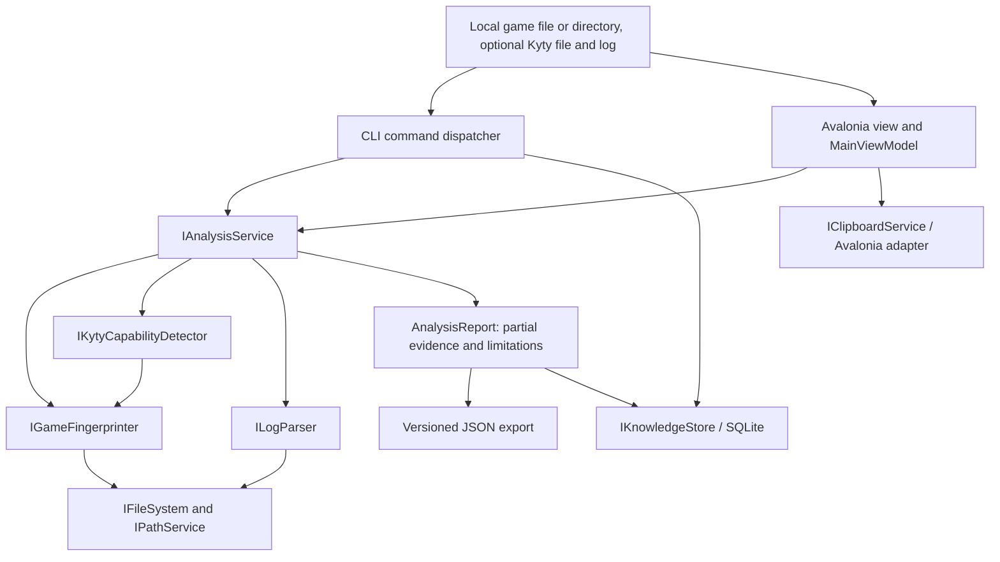
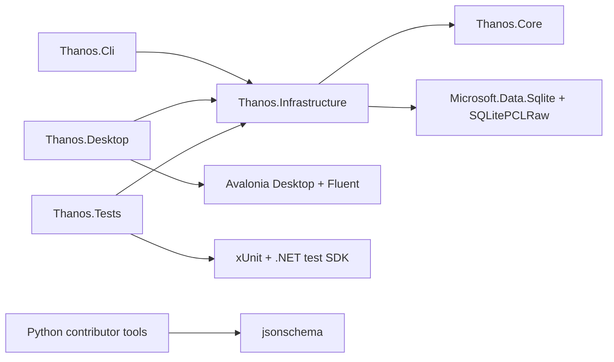
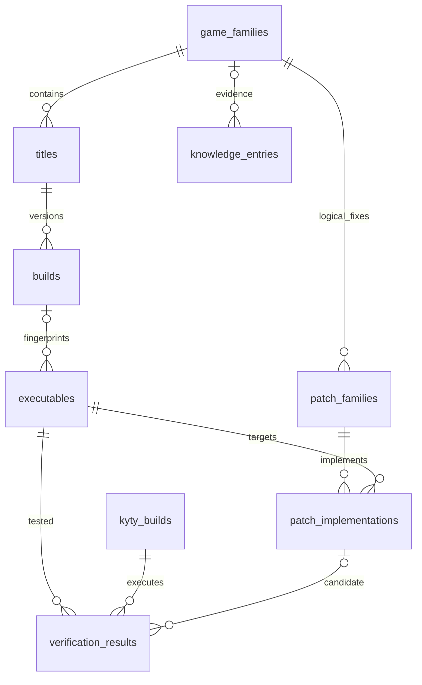
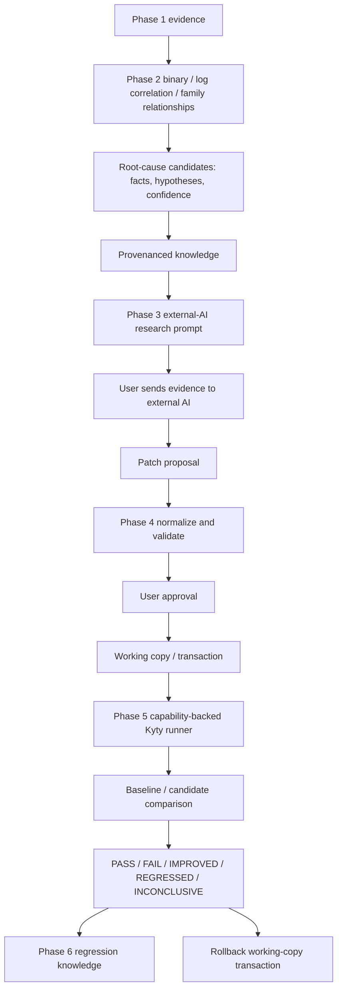

# Architecture

The diagram and original API below document the preserved Phase 1 evidence pipeline. Phase 2 adds a separate `IResearchService` and research wire contract; see [docs/PHASE2.md](docs/PHASE2.md) for the current composition, binary/diagnosis engines and additive SQLite migration. The CLI keeps `analyze` compatible while `diagnose` and desktop Analyze use Phase 2.

## Repository tree

```text
THANOS/
├── THANOS.sln
├── global.json / Directory.Build.props / Directory.Packages.props
├── README.md / ARCHITECTURE.md / ROADMAP.md / CHANGELOG.md
├── LICENSE / THIRD-PARTY-NOTICES / licenses/
├── CONTRIBUTING.md / CODE_OF_CONDUCT.md / SECURITY.md
├── .github/
│   ├── workflows/ci.yml
│   ├── ISSUE_TEMPLATE/{bug_report,feature_request}.md
│   └── pull_request_template.md
├── src/
│   ├── Thanos.Core/
│   │   ├── Models.cs / Contracts.cs / AnalysisService.cs
│   │   └── Thanos.Core.csproj / README.md / packages.lock.json
│   ├── Thanos.Infrastructure/
│   │   ├── PlatformServices.cs / Fingerprinting.cs / KytyLogParser.cs
│   │   ├── JsonData.cs / AppLogger.cs
│   │   ├── Storage/{schema-v1.sql,SqliteKnowledgeStore.cs}
│   │   └── Thanos.Infrastructure.csproj / README.md / packages.lock.json
│   ├── Thanos.Cli/
│   │   └── Program.cs / Thanos.Cli.csproj / README.md / packages.lock.json
│   └── Thanos.Desktop/
│       ├── App.axaml / App.axaml.cs / Program.cs
│       ├── MainWindow.axaml / MainWindow.axaml.cs
│       ├── ViewModels/MainViewModel.cs
│       └── Thanos.Desktop.csproj / README.md / packages.lock.json
├── schemas/                      # 14 draft 2020-12 schemas and README
├── examples/                     # synthetic log, signature, relationship
├── tests/Thanos.Tests/            # evidence, storage, wire-contract tests
├── tools/                        # schemas, integration, notices and packaging
└── docs/PHASE1.md
```

## Phase 1 architecture



## Dependency graph

Arrows indicate compile-time dependencies. Core has only runtime/BCL dependencies.



## Cross-platform design

All projects target `net10.0`. Files, paths, environment, executable lookup and application-data location belong to infrastructure adapters. Core orchestrates interfaces without knowing Windows, Linux or macOS. Avalonia owns native file dialogs and the clipboard; these are UI integrations rather than analysis logic. SQLite native assets are supplied for Windows x64, Linux x64, macOS x64 and macOS ARM64 by the locked package graph.

`IFileSystem`, `IPathService`, `IEnvironmentService`, `IPlatformService` and `IExecutableDiscovery` have BCL adapters. `IClipboardService` has an Avalonia adapter. `IProcessRunner`, `IArchiveService` and `IKytyRunner` are contracts only: no process launch or extraction in Phase 1. Process requests use argument lists, explicit environment, working directory and timeout; future runners must avoid shell concatenation, bound stdout/stderr and kill process trees on timeout/cancellation.

Only executable lookup uses an OS branch (Windows PATHEXT), inside infrastructure. File paths are constructed with BCL path APIs. No WPF, Win32 P/Invoke or shell-based core analysis is used. Platform support for the application and support for a particular emulator build remain separate facts.

## Service API

`src/Thanos.Core/Contracts.cs` is the source of the compiling C# interfaces. The implemented service boundary is:

```csharp
Task<GameFingerprint> IGameFingerprinter.FingerprintAsync(string input, CancellationToken token);
Task<KytyFingerprint> IKytyCapabilityDetector.DetectAsync(string executable, CancellationToken token);
Task<ParsedLog> ILogParser.ParseAsync(string path, CancellationToken token);
Task<AnalysisReport> IAnalysisService.AnalyzeAsync(string game, string? kyty, string? log, CancellationToken token);
Task IKnowledgeStore.InitializeAsync(CancellationToken token);
Task IKnowledgeStore.SaveAnalysisAsync(string id, AnalysisReport report, CancellationToken token);
Task<AnalysisReport?> IKnowledgeStore.GetAnalysisAsync(string id, CancellationToken token);
```

Contracts for compatibility sources, patch providers, prompt templates/generator, Kyty adapters and runners establish extension points for later providers. Phase 2 implements IBinaryAnalyzer through its bounded ELF inspector and adds dedicated research, diagnosis, relationship and knowledge-store interfaces. Adding an interface does not claim an implemented feature. No fake pass results or placeholder patch bytes are exposed.

## CLI architecture

`kytyfixer` is a console application, independent of Avalonia. A strict command dispatcher accepts positional arguments and enumerated analyze options, rejects duplicates/unknown flags, calls shared services and emits camelCase JSON. Ctrl+C cancels ongoing evidence collection. SQLite initialization and analysis export are explicit subcommands. Later commands are documented as unavailable rather than silently succeeding.

## Avalonia architecture

`App` composes the same service graph as the CLI. `MainWindow` contains file-picker, export and clipboard adapters. `MainViewModel` implements observable properties and owns an async Analyze command, which prevents duplicate runs, performs analysis off the UI thread and displays a serialized report. Failed reanalysis clears the prior report to prevent exporting stale evidence. No diagnosis, patching or parsing logic lives in the views. The shell supports path entry, native browse, analyze, JSON export and clipboard copy. Drag/drop and richer result panels are later UI work.

## Data and storage

`Models.cs` defines immutable records with explicit nullable unknowns, separate address spaces, evidence references and provenance. JSON uses string enums and `schemaVersion: 1`. Confidence and readiness wire values are fractions in `[0,1]`; an unknown game identity has confidence zero even when its hash is exact. Confidence refers to identity, not hash quality.

The SQLite migration is the authoritative `src/Thanos.Infrastructure/Storage/schema-v1.sql`. `PRAGMA user_version` controls migrations; initialization is transactional and repeatable. A newer database is rejected. Parameterized inserts and reads protect identifiers from SQL injection. Duplicate analysis IDs are rejected instead of overwriting historical evidence. Report JSON retains the original log, avoiding filesystem dependency after export.



`analyses` stores Phase 1 report snapshots separately. Future normalized knowledge tables are created but not populated with speculative claims. Game family is the parent entity; title IDs are subordinate, and executable SHA-256 identifies exact accessible content. Knowledge and verification tables require provenance JSON. Status distinguishes unverified, community-reported, repeated, confirmed and tool-verified entries; no automatic promotion exists.

## Input boundaries and limitations

Fingerprinting streams the entire accessible file into SHA-256. ELF32/64 header inspection supports both byte orders and validates identification, size and version. Full segment/section mapping, symbols, imports, relocations, strings and function signatures are Phase 2. Unknown or protected containers remain partial, with no decryption claims. Directory discovery prefers a unique eboot.bin, then a unique ELF; ambiguity requires explicit selection. Inventory is bounded to 10,000 files and depth 32, excludes reparse points and reports inaccessible enumeration as an error.

The initial parser accepts strict UTF-8 (including BOM), up to 16 MiB, 100,000 lines and 65,536 characters per line. Regex calls have a 100 ms timeout and use only fixed internal patterns. Every line remains an ordered event, including unknown lines. Shader/Vulkan keywords, basic other categories, source locations and explicit PC/RIP fields are observed; categories and severity remain heuristic. Runtime PCs are not converted to file offsets. No final crash is automatically declared the root cause.

The detector fingerprints the selected file but does not authenticate it as Kyty. Capabilities are an empty list with `Unknown` status and version null. No guessed `--help`, game-loading, patch or debug arguments are executed. A future adapter must establish actual capability evidence for the exact build before constructing a launch request.

Application logs are JSON Lines in platform-local application data. Logging failure does not discard collected evidence. Raw user input is retained in explicit evidence exports, not application logs. Archives, scripts and AI output are not executed or extracted.

## Later workflow



A future patch must validate identity, build, hash, signatures, address mapping, original bytes, match count and ranges. These schemas alone are not a binary patch validator. AI scripts must never be auto-executed. Regression records must retain exact game, Kyty and hardware context. Optimization comes only after compatibility and stability are established.
