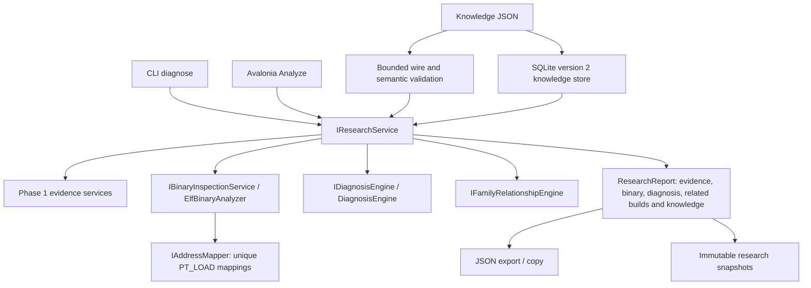

# Phase 2: compatibility research

Input collection was extended after the initial Phase 2 implementation: [complete logs and archive/package inputs](INPUTS.md), informed by the [local Kyty source review](KYTY_SOURCE_MAP.md).

Version 0.2.0 adds error signatures/correlation, root-cause candidates, accessible ELF inspection, build relationships and a provenanced local knowledge base. It preserves the Phase 1 JSON formats and implements no AI prompts, game modifications, patch execution or emulator runner.

## Shared architecture



`IAnalysisService` and its `AnalysisReport` remain the basic compatibility boundary. `IResearchService` composes these services with the new engines. `IBinaryAnalyzer` also returns an enriched, wire-compatible GameFingerprint; `IBinaryInspectionService` exposes the detailed independent BinaryInspection contract. No front end implements binary/log/relationship logic.

## Commands

Use the CLI executable directly, or prepend `dotnet run --project src/Thanos.Cli -c Release --no-build --` to each command below:

```sh
kytyfixer binary-info ./Game/eboot.bin
kytyfixer diagnose ./Game --log ./kyty.log
kytyfixer diagnose ./Game --kyty ./Kyty --log ./kyty.log --related ./Related/eboot.bin --database ./knowledge.db
kytyfixer diagnose ./Game --log ./kyty.log --knowledge ./knowledge.json
kytyfixer map-address ./Game/eboot.bin virtualAddress 0x400100 fileOffset
kytyfixer map-address ./Game/eboot.bin runtimeAddress 0x500100 fileOffset 0x100000
kytyfixer compare-builds ./BuildA/eboot.bin ./BuildB/eboot.bin
kytyfixer compare-builds ./BuildA/eboot.bin ./BuildB/eboot.bin --knowledge ./knowledge.json
kytyfixer diff-binaries ./original.elf ./candidate.elf
kytyfixer knowledge import ./knowledge.db ./knowledge.json
kytyfixer knowledge export ./knowledge.db
kytyfixer database export-research ./knowledge.db RESEARCH_ID
```

Replace example addresses with observed addresses; they are not offsets for any real game. Unknown/unavailable binary evidence is a successful partial research result, with `unsupported`, `malformed` or `limited` binary status and explicit limitations. File access/invalid command data errors return 3; invalid command syntax returns 2. A research report is not a compatibility PASS. `diagnose --database` uses stored knowledge and saves a report ID on stderr; direct `--knowledge` is an alternative and cannot be combined with `--database`.

The Avalonia shell accepts a game, optional log/Kyty, optional knowledge JSON and related-build ELF. Analyze shows a Phase 2 research report and its root-cause candidate summary; export/copy preserves the same JSON. Concurrent analysis is disabled and a failed new analysis clears the previous export. Native dialogs/rendering remain manual acceptance checks; view-model state and all shared engines are tested without launching native UI.

## Diagnosis semantics

Built-in literal signatures cover unsupported shader instructions, selected Vulkan errors, loader failure, missing modules, unimplemented syscalls and memory access violations. Their provenance identifies THANOS heuristic policy; they do not pretend to be verified Kyty fixes. Imported tokens are literal substrings, not regular expressions or executable code. Category, failure severity and every token must match on the same event.

The first observed non-termination error is the primary **candidate**. Later matching-category effects within 25 lines may be secondary; shader failures may correlate with graphics/Vulkan failures and termination. Other/distant failures remain independent. A temporal association does not prove causality. The final crash is never automatically the root cause.

Candidate records contain facts copied from log observations, exact source/line evidence, separate hypotheses, confidence and a recommendation. Confidence is a heuristic score, capped at 0.7 for signatures even if the imported rule reports higher confidence. Missing logs, unrecognized failures or termination alone produce UNKNOWN, zero confidence and no fabricated hypothesis. No-error counters and negated unsupported-instruction statements are excluded from initial severity matching. Lexical parsing remains imperfect; context and reproducible emulator diagnostics are still needed.

## Accessible binary analysis

The reader follows the generic [ELF ABI](https://gabi.xinuos.com/elf/02-eheader.html) layout for ELF32/64 in either byte order. It reads header/table ranges through a seekable stream and validates entry sizes, string/symbol/relocation references, PT_LOAD file/memory sizes, load alignment and address overflow. ELF extended section counts/name indexes are read from section zero; malformed tables expose no trusted mapping/code inventory. NOBITS sections have memory size but no file bytes.

Available results include sections, segments, load mappings, symbols, dynamic import/export names, numeric relocation kinds with symbols/addends, bounded ASCII strings, executable-section hashes and hashes of symbol-bounded functions. These are exact raw-byte hashes, not relocation-normalized signatures or disassembled instruction patterns. Stripped files may provide executable PT_LOAD hashes while symbol/dynamic recovery remains unavailable. Symbol-only zero-filled or special section indexes are not treated as executable code.

`codeInventoryComplete` describes the executable-section/segment hash inventory, not complete instruction/function analysis. Different binaries with incomplete code coverage cannot receive a similarity-based relationship score. Matching a complete file hash remains exact-byte evidence even if bounded structural detail is limited.

Address conversion is unique, bounded PT_LOAD mapping between file offset and virtual address. Runtime conversion requires a supplied load bias and guards underflow/overflow. Relative addresses require a specific section/function base and return UNKNOWN rather than guessing. Overlapping mappings and addresses only in zero-filled memory cannot become a file offset. No patch validator is implemented here.

| Bound | Behavior |
| --- | --- |
| 4,096 entries per ELF section/program table | Excess yields limited analysis without trusted tables |
| 50,000 symbols and 50,000 relocations | Excess yields limited analysis |
| 8 MiB per ELF string table and decoded symbol-name character budget | Excess yields limited analysis; repeated symbol names are cached |
| 32 MiB initial ASCII scan, 4,096 strings, 256 characters each | Truncation is reported |
| 256 MiB code hashing, 64 KiB per symbol-function hash, at most 8,192 code records | Bounded evidence; larger/omitted functions are not claimed inspected |
| Binary difference: 256 MiB scan, 4,096 ranges, 64-byte previews, 16-byte contexts | Truncated flag and explicit prefix-only changed-byte totals |
| Knowledge: 16 MiB JSON, 10,000 records, 512 imported signatures | Rejected before mutation or rolled back transactionally |
| Logs and signature matches | No configured byte/line/line-length/match count limits; full evidence needs available memory |

File SHA-256 covers the complete accessible input even when detailed inspection is limited. Strings use ASCII; UTF-16, compressed sections, sectionless dynamic-symbol recovery, SHN_XINDEX symbol-index decoding, proprietary ABI relocation semantics and instruction disassembly are explicit limitations. Unrecognized/protected containers are not decrypted and still support hash/log research. Binary differences are position-based; insertions can shift subsequent bytes, and changed bytes are not automatically the logical fix.

## Family relationships

Similar title IDs, filenames and generic strings do not establish a family. The relationship engine requires inspectable code and compatible architectures. Matching complete file bytes with code produce a STRONG relationship, while identical executable sections can produce STRONG/PROBABLE/WEAK evidence depending on coverage and specific export overlap. Shared engine/library code remains an alternative explanation.

EXACT FAMILY is reserved for explicit confirmed/tool-verified bindings assigning both executable hashes to the same family. Conflicting trusted families produce UNKNOWN. Imported provenance statuses are source assertions, not newly verified results. Incomplete code inventories with no trustworthy code evidence produce UNKNOWN. No offset, patch or code-equivalence transformation is reused automatically.

## Knowledge and migrations

KnowledgeBundle contains game families, exact-hash family bindings, logical patch families, issue/fix/compatibility entries, signatures and relationships. Every claim has provenance (source, author if known, date, emulator/game version and hardware if known, verification status). `examples/knowledge.json` is an empty synthetic family example, not real compatibility knowledge.

An entry's supplied selectors are conjunctive: its hash, family and signature conditions must all match when present. An entry with no selector is invalid. Unverified family bindings remain related claims; fingerprint assignment requires both a trusted family record and trusted exact-hash binding. Matching a known fix never asserts that it was applied or verified on the current build. Patch families describe logical fixes and provenance, not executable modifications.

Selector matches surface historical claims with their original Kyty/game version and hardware provenance. Those context fields do not establish applicability to the current environment; the report explicitly requires separate verification before treating a recorded fix as usable.

The importer requires explicit wire fields/versions, rejects null required values and duplicate/unknown properties, and checks IDs, hashes, dates, enums, confidence, selectors and references. Schema files remain useful for external validation; runtime checks add semantic constraints. Import is transactional and additive. Identical existing family records may be reused as dependencies; other duplicate IDs or changed family content/provenance are rejected. Conflicts never overwrite evidence or promote status silently. Export preserves timestamps/statuses (equivalent UTC timestamp spellings may normalize).

SQLite migration `Storage/schema-v2.sql` adds research snapshots, family bindings, signatures, relationship records and a patch-family JSON column. It preserves all version 1 tables and reports. Initialization applies versions 1→2 atomically and rejects newer database versions. Analysis/research IDs are immutable. Knowledge export uses a transaction for a consistent snapshot.

## Validation

Use the README build/test/format/schema/publication commands. The suite covers both ELF classes/byte orders, malformed tables/overflow/links, NOBITS, extended numbering, address ambiguity/load bias, difference ranges across I/O chunks, UNKNOWN diagnosis, independent errors, negative failure statements, literal signatures, conservative/trusted family relationships, provenance, rollback, v1 migrations and desktop stale-export prevention. CLI integration validates both Phase 1 and Phase 2 exports against the schema registry, including the published CLI. No real-game compatibility or native UI interaction is claimed by these tests.
