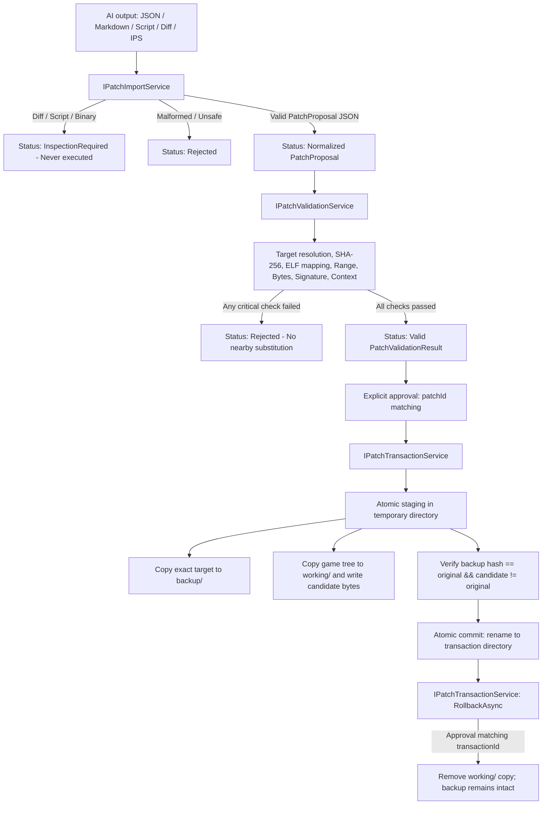

# Phase 4: patch validation and working-copy transactions

Version 0.4.0 adds AI patch normalization, guarded validation against accessible game binaries, and transactional working-copy creation with rollback. It executes no AI scripts, runs no emulator, modifies no original game files, and leaves existing evidence, research, prompt, and package contracts intact. Phase 4 introduces `patch-import`, `patch-validation`, and `patch-transaction` v1 contracts and extends `common-schema-v1.json` with `PatchCheck`.

## Workflow overview



## CLI commands

```sh
kytyfixer normalize-patch ./ai-output.md --output ./patch.json
kytyfixer validate-patch ./patch.json --game ./Game
kytyfixer validate-patch ./patch.json --game ./Game/eboot.bin --research ./research.json
kytyfixer apply-patch ./patch.json --game ./Game --transaction ./tx-01 --approve synthetic-patch
kytyfixer rollback ./tx-01 --approve TRANSACTION_ID
kytyfixer rollback ./tx-01 --approve TRANSACTION_ID --restore-original ./Game
```

All commands emit JSON to stdout. Nonzero exit codes: `2` for invalid syntax, missing required options, or unrecognized arguments; `3` for input errors, failed critical validations, transaction conflicts, or approval mismatches; `130` for cancellation.

### normalize-patch
Accepts a path to AI output. Supports pure JSON, JSON inside Markdown code fences (```json ... ```), source diffs (`.diff`, `.patch`), scripts (`.py`, `.sh`, `.ps1`, `.bat`, `.cmd`, `.cs`), binary patches (`.ips`, `.bps`, `.xdelta`, `.vcdiff`, `.patchbin`), and non-UTF8/binary files.
- Pure or fenced JSON is deserialized with strict shape validation (no trailing commas, comments, or unexpected fields). It normalizes string whitespace, formats byte sequences and hex values, ensures equal-length original and replacement sequences, validates address spaces, and verifies that provenance remains `unverified` and starts with `external-ai`.
- Diffs, scripts, and binary patches return `InspectionRequired` with explicit findings and limitations explaining that source intent cannot be treated as validated bytes. They are **never executed or compiled**.
- Malformed, corrupt, resizing, identity-mutating, or traversal-attempting inputs return `Rejected`.
- `--output` writes the normalized `PatchProposal` JSON only when normalization succeeds; it fails with exit code 3 if the input is not normalizable.

### validate-patch
Validates a normalized `PatchProposal` against a game directory or regular file, with optional research snapshot comparison.
Critical checks include:
1. **Target file**: Resolves the target relative path inside the game root without symlink/reparse-point traversal or container escapes. Container/archive inputs (ZIP, ZAR, PKG) are rejected; patches require a real filesystem target.
2. **Target SHA-256**: The regular file on disk must match `patch.sha256` exactly.
3. **ELF format & architecture**: Must be an accessible ELF32/ELF64 with recognized architecture.
4. **Identity & research context**: If a `ResearchReport` is provided, game SHA-256, title IDs, versions, and game family must match the proposal.
5. **Address mapping**: Translates `Location` to a file offset. `fileOffset` is verified against file bounds; `virtualAddress` is mapped via unique file-backed `PT_LOAD` segments. Runtime and relative addresses without load bias or file mapping are rejected.
6. **Modification range**: The modification must fall completely within a single file-backed `PT_LOAD` segment.
7. **Original bytes**: Target bytes at the mapped file offset must match `patch.originalBytes` exactly.
8. **Signature match count & location**: The signature pattern (hex bytes and `??` wildcards) must match the target file exactly `expectedMatches` times, and must match at the exact mapped offset. **Nearby matches are never substituted.**
9. **Replacement bytes**: Replacement bytes must be equal in length to original bytes and distinct from them.

### apply-patch
Creates an isolated transaction containing a pristine backup and a separate patched working copy.
- Requires `--game`, `--transaction`, and `--approve <patchId>`. The approval argument must match `patch.patchId` exactly.
- Destination directory must not already exist and cannot be located inside the original game directory.
- Atomic execution: work is staged in a hidden temporary sibling directory (`.thanos-transaction-...`).
- Reads and hashes the target under a shared read lock to guarantee it hasn't changed since validation.
- Preserves the exact target in `<transaction>/backup/<relativePath>`.
- Replicates the game folder structure (or file) in `<transaction>/working/` and modifies only the target in the working copy.
- Verifies that `backup` matches the original hash and `working` candidate hash differs from the original.
- Emits `<transaction>/patch.json` and `<transaction>/transaction.json`.
- Atomically moves the temporary directory to the final destination.
- **The original game root is NEVER modified during apply.**

### rollback
Reverts a transaction using its recorded metadata.
- Requires `<transaction-directory>` and `--approve <transactionId>`. Approval must match the recorded `transactionId`.
- Verifies that the transaction directory is a genuine directory and not a reparse point.
- Deletes the `<transaction>/working/` tree, leaving `backup/`, `patch.json`, and `transaction.json` intact.
- Updates `transaction.json` status to `rolledBack`.
- Optional `--restore-original <exactOriginalRoot>`: Restores the backup target back to the original game root ONLY if the caller explicitly approves and provides the exact original root recorded in the transaction. If the current target on disk differs from the original, displaced bytes are safely copied into `<transaction>/recovery/` before restoration.

## Desktop shell (Avalonia)

The Avalonia desktop GUI adds a dedicated **Patch validation / transaction** tab:
- **Patch / AI output**: Select any AI proposal, Markdown response, script, diff, or binary patch.
- **Transaction**: Specify a new directory for apply, or an existing transaction directory for inspection/rollback.
- **Inspect / normalize**: Runs normalization in the background; displays `PatchImportResult` JSON.
- **Validate target**: Enabled when a patch is normalized; validates against the selected game path; displays `PatchValidationResult` JSON with detailed pass/fail checks.
- **Create working copy...**: Enabled only when all critical validation checks pass. Prompts with a confirmation dialog detailing the patch ID, target path, and transaction directory. Requires explicit user approval before calling `ApplyApprovedAsync()`.
- **Inspect transaction**: Reads and displays existing transaction metadata.
- **Rollback working copy...**: Prompts with confirmation of transaction ID; removes the working copy.
- **Restore original from backup...**: Prompts with confirmation of transaction ID and original root; restores pristine bytes and preserves displaced files in recovery.

## Contracts and schemas

| C# model | Schema | Purpose |
| --- | --- | --- |
| `PatchImportResult` | `patch-import-schema-v1.json` | Normalization outcome, detected format, findings, and limitations |
| `PatchValidationResult` | `patch-validation-schema-v1.json` | Detailed checks, resolved target, SHA-256, mapped offset, limitations |
| `PatchTransaction` | `patch-transaction-schema-v1.json` | Transaction identity, status, timestamps, roots, hashes, and offsets |
| `PatchCheck` | `common-schema-v1.json#/$defs/PatchCheck` | Individual validation check name, status, criticality, detail, evidence |

Existing `PatchProposal` (`patch-schema-v1.json`) wire schema is preserved without breaking changes.

## Safety invariants

1. **Read-only original inputs**: `apply-patch` never writes to, renames, or modifies original game files or directories.
2. **Isolated working copies**: All modified binaries live exclusively inside the separate transaction working directory.
3. **No automatic script execution**: AI-generated Python, Bash, PowerShell, C# code, or unified diffs are tagged as `InspectionRequired` and never executed or compiled.
4. **No fuzzy offsets**: Patches must match exact offsets, file-backed PT_LOAD bounds, exact original bytes, and exact signature occurrences. No nearby offset guessing is ever performed.
5. **No path traversal**: Relative target paths are sanitized to prevent directory traversal (`..`) or symbolic-link escapes.
6. **Explicit approval**: Both patch application and rollback require explicit matching IDs, preventing accidental or automated invocation.
