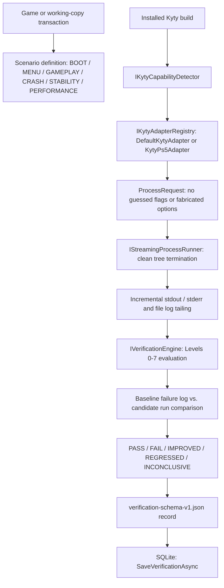

# Phase 5: emulator runner and verification levels

Version 0.5.0 adds capability-backed Kyty execution, scenario definitions, streaming stdout/stderr/log capture without configured limits, baseline vs. candidate log comparison, and verification level 0–7 outcome evaluation. It introduces the `verify` CLI command and the desktop Verification & Runner panel, strictly adhering to `verification-schema-v1.json`.

## Workflow overview



## Verification levels (0–7)

| Level | Name | Observable milestone |
| --- | --- | --- |
| 0 | `None` | Failed or crashed prior to ELF loading; immediate host fault. |
| 1 | `Boot` | Runtime linker initialized, host subsystems started, guest code entered. |
| 2 | `Intro` | Host display window created, swapchain active, title/splash frame rendered. |
| 3 | `Menu` | Interactive UI or main menu accepting input. |
| 4 | `InGame` | Game world or stage loaded; 3D/2D gameplay loop active. |
| 5 | `Playable` | Sustained gameplay without fatal exceptions or asserts for scenario duration. |
| 6 | `Complete` | Scenario objectives or complete campaign sequences reached. |
| 7 | `Perfect` | Zero audio/video glitches, zero fatal asserts, performance within target metrics. |

## Verification scenarios

| Scenario | Target level | Description & required evidence |
| --- | --- | --- |
| `BOOT` | 1 | Verifies ELF mapping, subsystem initialization, and guest code entry (`runtimeLinker`, `InitAll`, `guest execution`). |
| `MENU` | 3 | Verifies display window initialization and main menu / UI interaction (`menu`, `ui`, `controller`, `scene`). |
| `GAMEPLAY` | 4 | Verifies level loading and gameplay scene execution (`gameplay`, `world`, `level`, `stage`). |
| `CRASH REPRODUCTION` | 1 | Validates whether candidate working copy eliminates specific baseline crash signatures. |
| `STABILITY` | 5 | Requires sustained execution without unhandled exceptions or asserts for at least 15 seconds. |
| `PERFORMANCE` | 7 | Measures frame stability and throughput without dropped frames or asserts. |

## CLI commands

```sh
# Run live verification with installed Kyty emulator
kytyfixer verify ./Game --kyty ./Kyty.exe --scenario BOOT
kytyfixer verify ./Game --kyty ./Kyty.exe --scenario MENU --timeout 45 --output ./verification.json

# Verify a working-copy transaction
kytyfixer verify ./Game --kyty ./Kyty.exe --transaction ./tx-01 --scenario BOOT

# Offline verification from existing candidate and baseline logs
kytyfixer verify ./Game --scenario BOOT --candidate-log ./candidate.log
kytyfixer verify ./Game --scenario MENU --baseline-log ./baseline.log --candidate-log ./candidate.log --database ./thanos.db
```

### Exit codes
- `0`: verification succeeded (outcome evaluated and JSON emitted).
- `2`: invalid syntax or missing required options.
- `3`: input error, invalid game/log path, or execution error.
- `130`: canceled.

## Safety and verification rules

1. **No guessed options**: Adapters only generate arguments explicitly proven by detected capabilities or user configuration. Flags like `--headless` or `--novideo` are never assumed.
2. **Real scenario evidence for PASS**: A zero exit code alone is not compatibility proof; required positive milestone logs must be verified.
3. **Missing proof produces INCONCLUSIVE**: Incomplete logs or timeouts prior to milestone proof yield `inconclusive`.
4. **Clean process tree termination**: Processes that time out or receive cancellation tokens are killed with `Kill(entireProcessTree: true)`.
5. **No buffer limits**: Stdout, stderr, and log capture stream continuously without byte or line count caps.
6. **Additive persistence**: Confirmed verification results in SQLite cannot be silently overwritten.
